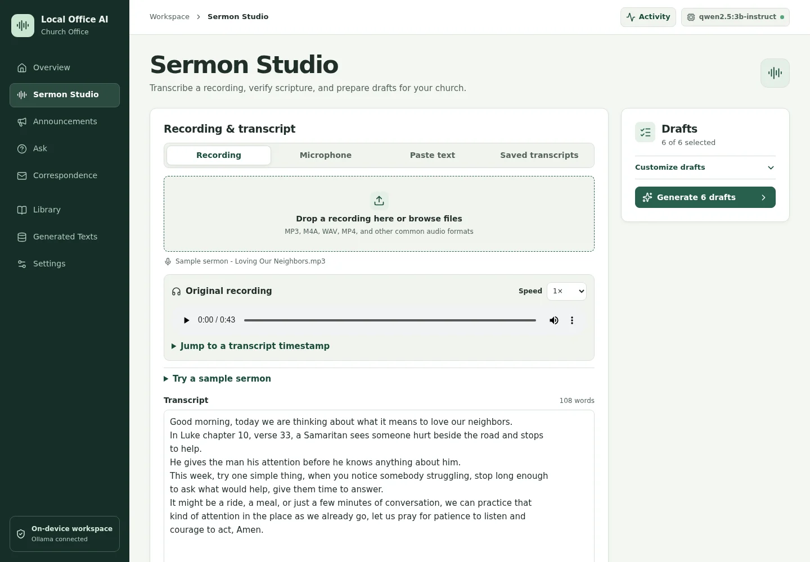

# A first run for church office teams

Turn a sample sermon into a draft, then look up a fact in a sample office policy. The exercises use fictional office details and the recording bundled with the app.

## Open the workspace

After the [one-time pilot setup](../README.md#single-machine-pilot-install), use the launcher for your computer and open [Local Office AI](http://127.0.0.1:8000/) in your browser. Check **Settings → Local system** if transcription or the local model is unavailable.

[Watch the visual walkthrough](images/browser-demo.webp)

## 1. From recording to sermon summary

1. Open **Sermon Studio**. Expand **Try a sample sermon**, then choose **Transcribe sample MP3**. Your own MP3 can be uploaded with **Drop a recording here or browse files**.
2. Use **Original recording** to listen back. **Jump to a transcript timestamp** takes you to the matching audio. Edit any mistakes in the transcript and use **Check scripture** to check references against the local World English Bible.
3. Under **Customize drafts**, select **Clear all**, then **Sermon summary**. Choose **Generate 1 draft**.
4. Switch to another page while the model works. Open **Activity → Open draft** to return to the exact job. Refreshing the browser at that link reopens the job and its result.
5. Review the summary before sharing it. Choose **Download Word** or **Download Markdown**, or open **View in Generated Texts**. The archive tracks the workflow, model, and time. You can add tags and mark the text reviewed.

## 2. Look up a fact in Office documents

1. Download the [sample room-use policy](examples/sample-room-use-policy.txt). In **Library**, upload the file and wait for indexing to finish.
2. Open **Ask → Office documents** and enter: “How many people does the fellowship hall seat?”
3. The example policy says **72 people**. Open the cited passage and compare it with the question. For a second exercise, ask about the hall’s rental price. The example policy provides no price. Related excerpts can still appear, so look for the specific fact in the source.

In **Ask**, use **General** to brainstorm or **Bible & Christianity** for scripture and Christian questions. Use **Clear chat** to clear the active chat thread.

## 3. Start a volunteer thank-you

1. Open **Correspondence → New message**. In **Message templates**, select **Volunteer appreciation**, then **Use template**.
2. Address the sample message to Avery. Use “Thank you for helping at the food pantry” as the subject. Mention that Avery sorted donations on Saturday and helped prepare grocery boxes.
3. Review the message and choose **Save draft**. Use **Export email** to open it in your mail client, or **Export Word** for a letter.

For an announcement, open **Announcements**, choose a notes starter, and replace its sample details with the event’s date, place, and contact before generating drafts.
